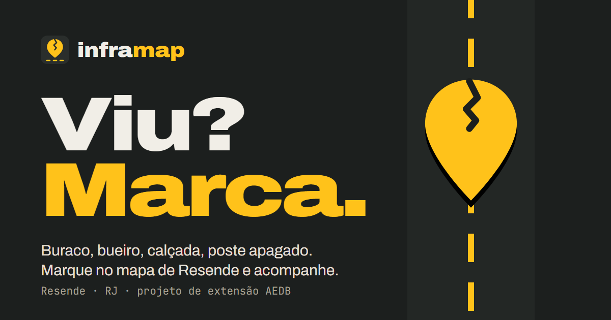
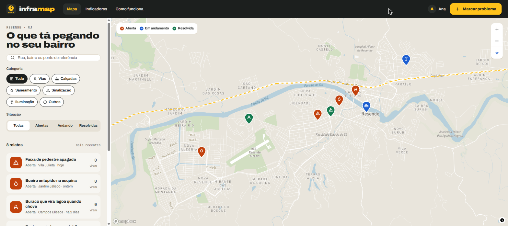
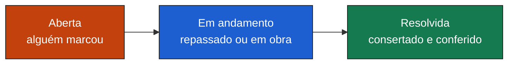
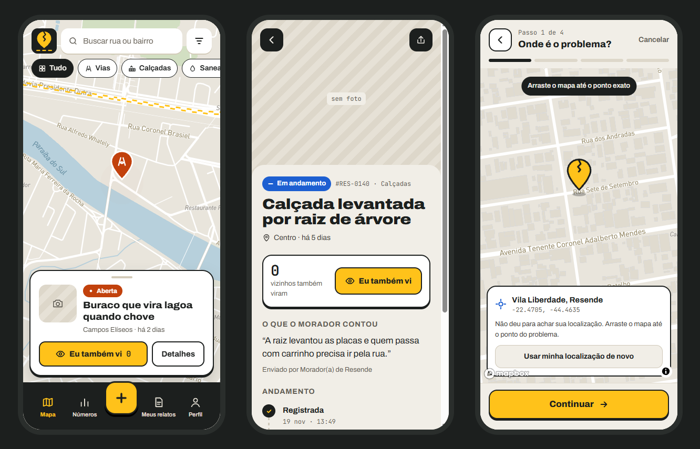
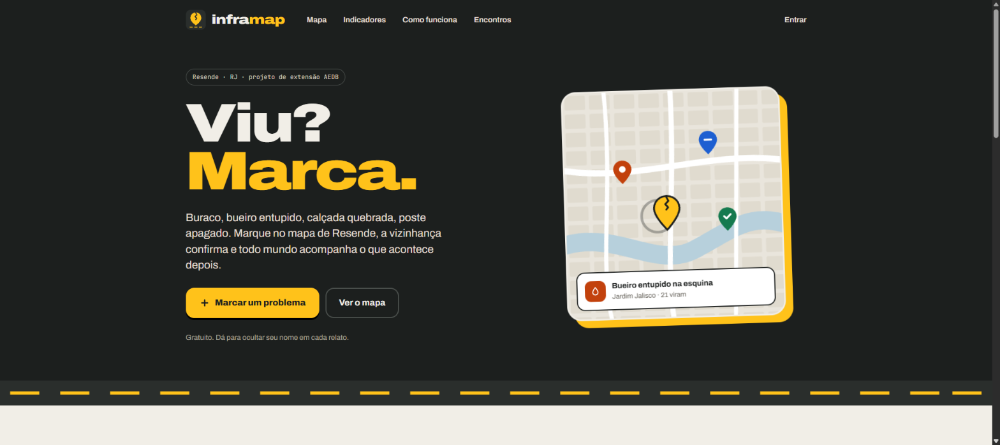

  

  

  
  
  
  

 

Todo mundo em Resende conhece aquele buraco que está lá há meses. Alguém reclama no grupo do bairro, três pessoas respondem "aqui também", a mensagem some no meio de bom dia e figurinha, e no mês seguinte o buraco continua no mesmo lugar.

O **InfraMap** é o lugar para essa reclamação não se perder. Você marca o problema no mapa da cidade, os vizinhos confirmam que também viram e qualquer pessoa acompanha o que aconteceu depois. Buraco, bueiro entupido, calçada quebrada, placa caída, poste apagado.

É um projeto de extensão de alunos da AEDB, feito para Resende.

  

As imagens desta página usam relatos de exemplo.

## Como funciona

**1. Viu? Marca.** Abra o site no celular, toque no **+** amarelo e arraste o mapa até o ponto do problema. Se o GPS estiver ligado, ele já começa onde você está. Escolha a categoria, tire uma foto se der e conte em uma frase o que está acontecendo. Leva menos de um minuto.

**2. A vizinhança confirma.** Quem passa pelo mesmo lugar toca em **"Eu também vi"**. Com 5 confirmações, o relato ganha o selo de confirmado pela vizinhança. Um buraco que 30 pessoas confirmaram pesa mais do que uma reclamação solta.

**3. Todo mundo acompanha.** A equipe do projeto confere os relatos, junta os repetidos e leva os casos para quem resolve. Cada mudança aparece na linha do tempo do relato, com data e uma nota explicando o que foi feito.

  

## O que dá para marcar

| Categoria          | Exemplos                                                     |
| ------------------ | ------------------------------------------------------------ |
| **Vias e buracos** | buraco, asfalto afundado, meio-fio quebrado                  |
| **Calçadas**       | calçada quebrada, raiz levantando placa, falta de rampa      |
| **Saneamento**     | bueiro entupido, esgoto a céu aberto, ponto de alagamento    |
| **Sinalização**    | placa caída, faixa de pedestre apagada, semáforo com defeito |
| **Iluminação**     | poste apagado ou piscando                                    |
| **Outros**         | o que não se encaixar nas de cima                            |

Ficou na dúvida? Marque em **Outros**. A equipe reorganiza depois.

## Os números da cidade

Na aba **Números**, qualquer pessoa vê quantos relatos existem, quantos já foram resolvidos, quais bairros concentram mais problemas e como isso muda semana a semana. Dá para filtrar por bairro, categoria e período, e baixar tudo em planilha (CSV) para levar a uma reunião da associação ou à Câmara.

O projeto tem duas metas para este semestre: **80 relatos no mapa** e **50 moradores cadastrados**. O placar fica na mesma página.

  

## Perguntas que a gente sempre ouve

<b>Isso é da prefeitura?</b>

 

Não. O InfraMap é um projeto de extensão de estudantes da AEDB. A gente organiza os relatos e leva os dados para a prefeitura e para as concessionárias, mas não é um canal oficial e não consegue garantir prazo de conserto. Para emergência, como fio caído ou vazamento grande, ligue direto para a concessionária ou para a Defesa Civil.

<b>Preciso criar conta?</b>

 

Para olhar o mapa e os números, não. Para marcar, confirmar ou denunciar um relato, sim. Dá para entrar com a conta do Google, em dois toques, ou com o seu e-mail: chega um código de 6 números e você digita na tela. Não tem senha para decorar.

A conta existe para um motivo simples: sem ela, uma pessoa só conseguiria encher o mapa de relatos falsos ou confirmar o próprio relato vinte vezes.

<b>Meu nome aparece?</b>

 

Aparece só o primeiro nome e a inicial do sobrenome, tipo "Maria S.". Se preferir, ligue **"Ocultar meu nome neste relato"** na hora de marcar e o relato sai como "Morador(a) de Resende". O seu e-mail nunca aparece para ninguém, nem para a equipe na hora de cuidar dos relatos.

<b>E a foto? Ela mostra onde eu moro?</b>

 

A foto é diminuída e convertida no seu próprio celular antes de sair dele, e nesse processo a localização escondida no arquivo é apagada. O que fica público é só o ponto que você marcou no mapa. Evite fotografar rosto e placa de carro. Se alguém fizer isso, qualquer pessoa pode tocar em "Denunciar" e a equipe tira do ar.

<b>Vi um problema que já está no mapa. Marco de novo?</b>

 

Não precisa. Se você tentar marcar algo da mesma categoria a menos de 50 metros de um relato aberto, o InfraMap avisa e sugere confirmar o que já existe. Confirmar ajuda mais do que repetir.

<b>Funciona no meu celular?</b>

 

É um site, não precisa instalar nada. Foi testado em tela pequena (360 pixels de largura, a de muito celular de entrada) e a página inicial carrega com uns 120 KB. Se quiser, dá para adicionar à tela inicial pelo menu do navegador e ele abre como um aplicativo.

<b>Tem limite de relatos?</b>

 

Cada pessoa pode marcar até 10 problemas a cada 24 horas. É uma trava contra abuso, não deve atrapalhar ninguém que esteja marcando o próprio bairro.

<b>O que acontece com os meus dados?</b>

 

Guardamos o e-mail da sua conta, o nome que você escolheu e o que você marcou no mapa. Não pedimos CPF, telefone nem endereço. Os detalhes estão na <a href="https://inframap-g3.vercel.app/privacidade">política de privacidade</a> e nos <a href="https://inframap-g3.vercel.app/termos">termos de uso</a>.

## Acessível de verdade

O site funciona só com teclado, do primeiro "Pular para o conteúdo" até o envio do relato, e todas as páginas passam no verificador automático axe, no celular e no computador. Cada pino do mapa é lido em voz alta com o título, a categoria e a situação. As animações desligam sozinhas para quem pediu menos movimento nas configurações do celular.

## Quem faz

Grupo 3 de extensão da AEDB (Associação Educacional Dom Bosco), em Resende, com orientação do professor **Douglas Rosa Grillo**.

|                                  |                                  |
| -------------------------------- | -------------------------------- |
| Cauã Campos de Souza e Silva     | Isabella Leite Benjamim          |
| Guilherme Henrique Valim Soares  | João Gabriel Santos Juvenal      |
| Gustavo Pontes Mazoni            | Samuel Barbosa da Silva          |
| Igor Pontes Mazoni               | Weslley Candido Madeira da Rocha |
| Wendell Candido Madeira da Rocha |                                  |

O projeto se apoia no Objetivo de Desenvolvimento Sustentável 9.1 da ONU: infraestrutura de qualidade, confiável e acessível para todo mundo.

---

  <a href="https://inframap-g3.vercel.app"><b>Abrir o InfraMap</b></a>
  &nbsp;·&nbsp;
  <a href="docs/desenvolvimento.md">Guia para quem programa</a>
  &nbsp;·&nbsp;
  <a href="https://inframap-g3.vercel.app/privacidade">Privacidade</a>

